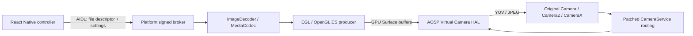

# Virtual Camera Pro

Android React Native controller, native media frame engine, and camera backends
for an inspected VMOS guest, a local Android Emulator environment camera, and a
controlled AOSP 16 CameraService integration.

The VMOS controller and guest broker now ship in **one APK**, with conditional
setup, approved automatic guest preparation, actual camera verification,
restore and recovery. [Download VirtualCameraPro.apk](artifacts/VirtualCameraPro.apk).
Version 2.2 adds adaptive setup and measured multi-lens routing. On the Samsung
SM-N986U / Android 13 host, all four VMOS guest cameras passed image/video
replacement, floating gestures, live transforms without reopening the camera,
independent camera crop requests, color checks and crash recovery. Setup and
permissions survived a VMOS shutdown/start without another setup approval.
See [device portability and acceptance](docs/DEVICE_PORTABILITY.md).
The accepted Infinix 2.1 APK and its [measurements](docs/CAMERA_MODES_ACCEPTANCE.md)
remain preserved; this 2.2 build has not been retested on that phone.

Read [installation and requirements](docs/UNIFIED_INSTALLATION.md) and the
[device acceptance report](docs/DEVICE_PORTABILITY.md). This non-debuggable
Release APK uses development signing with ancestry from this guest's public
platform test key; it is not a production trust configuration. Android 10–16
host compatibility remains conditional on the VMOS guest and actual device
tests; these results do not establish universal compatibility.

The delivered app includes **Front Camera Only**, **Back Camera Only** and
**Replace Both Cameras**, plus optional floating zoom/pan/reset controls inside
VMOS. Deactivate before changing replacement mode; both-camera mode shares one
playback timeline when another app switches lenses. See
[camera modes and controls](docs/CAMERA_MODES_AND_CONTROLS.md) for the guest
overlay-permission steps and the verification status of these additions.

**Earlier two-app regression baseline:**
Open **Virtual Camera Pro inside VMOS**, select an image or video and press
**Activate**. Run camera-consuming apps inside that same VMOS guest. Back/front
720p, back 1080p, image switching, looping video, real YUV/JPEG capture and
deactivation have passed actual on-phone tests. Separate Camera2 and CameraX
applications received selected image pixels with the controller backgrounded.
The inspected guest required a measured JPEG importer repair. See
[VMOS setup, exact compatibility and recovery](docs/VMOS_RUNTIME.md).

The stock camera used by the image-to-text app now also captures normal colors
inside this guest. The green-photo defect was traced to lost chroma during the
guest's 1920 × 1080 preview → 1920 × 1088 still resize and fixed with three
allocation-bound instructions. The matching independent capture test and the
actual OCR app's saved JPEG passed; see the
[before/after acceptance report](artifacts/vmos/green-fix-acceptance.json).
This result covers the inspected VMOS guest on this phone.

Camera-app zoom also passed in this guest: independent Camera2 sessions
verified centered/off-center crops and full-frame restoration with a back-camera
image and front-camera image/video sources at 720p, and the stock
Camera's two-finger pinch visibly zoomed the selected image in and back out with
matching crop metadata. See [crop acceptance](artifacts/vmos/crop-acceptance.json).
An app must send standard camera crop requests; a gesture used for focus does
not become panning automatically.

The earlier baseline controller, broker and helper APKs were installed with matching device
hashes and retested after a full guest restart. Crop controls passed again, and
the user's portrait produced normal stock-camera confirmation and saved JPEG
colors. At that baseline acceptance, the phone was left with that portrait active
on the guest front camera. The new one-APK acceptance is recorded separately above.
See [installed build verification](artifacts/vmos/final-installed-device-identity.json).

VMOS alpha13 has a startup setting issue: visit its host **Settings** screen
before starting the VM and keep **Camera** enabled. The guest broker recovers
its camera transport after guest reboot; a selected source requires a fresh
activation. This VMOS build is the only physical-phone VM profile verified so
far. Other devices, guest ROMs and Android host versions require their own tests.

**For this PC, use [the emulator runtime setup](docs/EMULATOR_RUNTIME.md).** The
prepared API 36 virtual device runs the platform-signed emulator broker and an
authenticated local companion. Selecting media and pressing Activate configures
the emulator's actual camera HAL; Active requires independent YUV/JPEG capture,
selected-source pixel verification, and a matching source hash.

The complete local acceptance passed: image/video switching, looping video,
Camera2 and CameraX in the background, original Camera preview/photos, and
restoration after deactivation. Evidence is in `artifacts/emulator-acceptance/`.

**The stock Android 10 system outside VMOS has no supported camera replacement
backend.** The Android 16 emulator backend does not operate the phone's stock
camera provider. See [physical-device support](docs/PHYSICAL_DEVICE_SUPPORT.md)
for the device findings, version limits and remaining port requirements, and
[verification results](docs/VERIFICATION.md) for measured results of each backend.

[Local emulator installation and checks](docs/EMULATOR_REFERENCE.md) use the PC
without requiring a physical phone.

## Build the Android components

Requirements: Node 22.11+, JDK 17, Android SDK 36, Build Tools 36.0.0, NDK
27.1.12297006. React Native 0.85.3, TypeScript, Kotlin, the New Architecture and
Hermes are used. Dependencies are pinned by `package-lock.json`.

```powershell
npm ci
npm run typecheck
npm run lint
.\scripts\build-android.ps1
npm start
# In another terminal, with an emulator/device connected:
npm run android
```

Eight Android modules are included:

| Module | Purpose |
| --- | --- |
| `app` | Gallery picker, native image/video preview, conditional setup, integrated private VMOS broker and trusted external-backend client |
| `broker` | Compile check of the privileged service against the SDK and pinned AIDL; install the Soong/platform-signed build through the system image |
| `emulator-broker` | Separate platform APK for the explicitly configured local Android Emulator environment camera and companion |
| `camera-client` | Independent Camera2 and CameraX preview/JPEG consumer and instrumentation tests |
| `system-tests` | SDK compile check for the separate, platform-signed AOSP acceptance APK; exercises actual image/video output, restoration and the original Camera app |
| `vmos-broker` | Shared exact-profile Android 9 ARM64 VMOS runtime; its separate legacy APK remains buildable for migration/regression |
| `guest-tools` | Explicit guest identity, staging and native transport diagnostics |
| `vmos-bridge` | Development-key-signed helper that enables ADB only inside the inspected VMOS guest |

The debug APK uses the standard development keystore. Release signing is not
configured for distribution. The AOSP broker allows the checked-in debug signing
certificate for controlled testing; use your own controller certificate when
integrating another build.

`android/app/build/outputs/apk/standalone/app-standalone.apk` contains its JavaScript bundle
and runs without Metro. It also uses the development signing certificate. The
regular debug variant uses Metro for development.
The standalone variant deliberately retains the debug native ABI to match its
React Android dependency; React Native developer support is disabled separately.
The delivered APK instead uses the true Release React Android/Hermes dependencies
and is non-debuggable. Its build log is
[release16-build.log](artifacts/unified/release16-build.log). Build and instrument
that variant with:

```powershell
cd android
.\gradlew.bat :app:assembleRelease
.\gradlew.bat :app:assembleReleaseAndroidTest -PcameraTestBuildType=release
```

On this PC, verified official Release AARs are also available through the
[exact-version local repository helper](artifacts/unified/release-dependencies/local-release-repository.init.gradle)
used by that build. The development root-authorization signing step is described
in [VMOS_DEVELOPMENT_ROOT_AUTHORIZATION.md](docs/VMOS_DEVELOPMENT_ROOT_AUTHORIZATION.md).
Ordinary users install the delivered single APK; they do not build or install the
test/diagnostic applications.

The controller is packaged for ARM64 and x86_64, with a minimum of Android 9
(API 28). These installation requirements do not establish a compatible system
camera backend on every Android version.

To repeat native media and compatibility tests on one explicitly selected phone:

```powershell
.\scripts\test-physical-device.ps1 -Serial YOUR_PHONE_SERIAL
```

This updates the controller and its diagnostic test applications, preserves app
data, and runs local EGL/MediaCodec tests. It does not install a system broker or
capture the physical camera. The report separately records
`virtualCameraVerified:false`.

## System image and acceptance tests

Follow [SYSTEM_IMAGE.md](docs/SYSTEM_IMAGE.md) on an x86_64 Linux/KVM build host.
`scripts/integrate-aosp.py` checks the exact AOSP tag, prints reviewable patches,
refuses to overwrite unrelated source edits, and installs the platform service,
SELinux rules and camera routing header. It supplies the dedicated
`vcam_cf_x86_64_phone-trunk_staging-userdebug` Cuttlefish product.

After booting that image:

1. Install the controller APK and choose an image or video.
2. Activate; the service validates decoding, registers the HAL, and installs its
   routing lease. It then opens the selected public ID through Camera2 and requires
   actual YUV frames, increasing timestamps and a valid JPEG, together with native
   producer delivery and CameraService's protocol 2 routing acknowledgement.
   Only successful verification produces the Active state.
3. Close and reopen the original camera app, or launch Camera Pipeline Test.
4. Preview and capture a photo. Video loops by default; disabling loop holds its
   last frame as a continuous camera source.
5. Deactivate and reopen the camera client to restore the physical camera ID.

[TESTING.md](docs/TESTING.md) covers pixel checks, video loops, restoration,
background use, stock Camera validation and crash recovery. Existing open camera
sessions and clients with cached physical-camera metadata must be reopened after
changing mode. This implementation redirects one selected public camera ID at a
time (default `0`); other camera IDs retain their usual behavior.
The selector queries actual IDs and lens facing from CameraManager; a missing
selected ID prevents activation. Missing system components produce a specific
error code and recovery action. Collect read-only evidence with
`python scripts/device-diagnostics.py --serial YOUR_SERIAL`.

## How frames reach other applications



Frames stay native. The broker copies a selected source into its private storage,
then decodes/render frames independently of JavaScript and the controller process.
Capture requests drive Surface submissions; video playback advances at a native
30 FPS cadence even when no camera consumer is open. A single atomic routing
record is renewed while the engine is healthy and expires within five seconds
after producer failure. Explicit deactivation clears it before unregistering the
virtual camera. A stable synthetic ID cleans up orphan registrations after a
broker restart. Sources and settings persist; activation requires a new user
action after a process restart or reboot.

## Layout

- `src/`, `specs/`: React Native UI, typed service and generated TurboModule spec.
- `android/app/`: Kotlin module, state manager, gallery and native preview.
- `native/frame-engine/`: EGL renderer, static image and MediaCodec video sources.
- `native/ipc/`: controller-to-system Binder contract.
- `native/camera-probe/`: public Camera2 YUV/JPEG verification and camera inventory.
- `aosp/system-service/`: foreground broker, HAL callbacks and source ownership.
- `aosp/camera-routing/`: C++ lease parser and exact upstream routing patch.
- `aosp/build-integration/`: product configuration and SELinux policy.
- `aosp/system-tests/`: platform-signed, separate-process system acceptance tests.
- `android/camera-client/`, `tests/`, `scripts/`: consumers, tests and build tools.

The provider, YUV conversion and JPEG encoder are the existing AOSP C++
implementation, included through Soong rather than copied or replaced with a
partial HAL. [Architecture and upstream references](docs/ARCHITECTURE.md).
